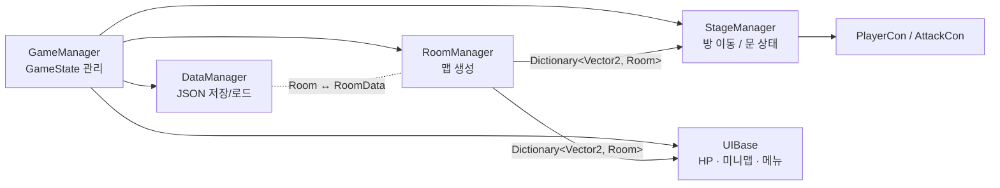
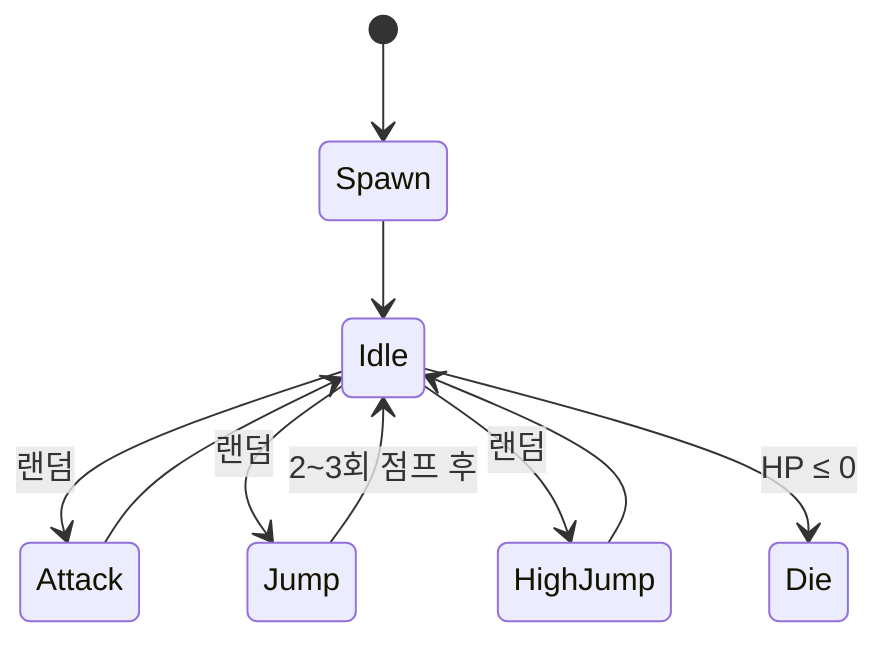
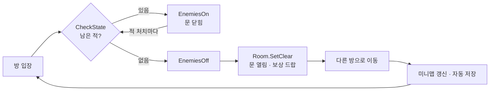

# 🎮 Isaac — The Binding of Isaac 모작 (Unity / C#)


| 항목 | 내용 |
|---|---|
| 엔진 / 언어 | Unity 2021.3 LTS / C# |
| 기간 | 2023 (개인 학습 프로젝트) |
| 구현 범위 | 절차적 맵 생성 · 플레이어 / 공격 · 몬스터 AI 4종 · 보스 · 아이템 · 미니맵 · UI · 세이브/로드 |

---
### ▶ 플레이 영상

[](https://www.youtube.com/watch?v=d0pF2D2rCds)

## 📐 전체 구조

모든 매니저는 제네릭 싱글톤 `GenericSingleton<T>` 하나를 상속받아 만들었고, 씬이 바뀌어도 유지되도록(`DontDestroyOnLoad`) 했습니다.
게임 흐름은 `GameManager`의 `GameState` enum 하나로 관리합니다.



```
Assets/Scripts
├── System/   GenericSingleton, GameManager, RoomManager, StageManager, DataManager, SoundManager
├── Player/   PlayerCon(이동), AttackCon(공격·풀링), BulletCon(눈물), PlayerStat
├── Enemy/    Monstro(보스 FSM), MaskAndHeart(Mask, Heart), Horf, RedMaw
├── Map/      Doors, Gate, TrapDoor
├── Item/     ItemManager, ItemSpawn, PickUpItem
└── UI/       UIBase, MiniMapUI, HpBarCon, EscUI, OptionUI, BossIntro ...
```

---

## 🔑 주요 구현 내용

### 1. 맵 생성 알고리즘 & 데이터 구조 — `RoomManager.cs`

**맵은 좌표를 키로 쓰는 딕셔너리**로 표현했습니다. 시작 방이 `(0, 0)`이고, 방마다 위·아래·좌·우 칸이 있는지만 확인하면 문을 열지 닫을지가 정해집니다.

```csharp
Dictionary<Vector2, Room> _rooms;   // 좌표 → 방 (씬 이름, 타입, 클리어 여부, 드랍 아이템)
```

**생성 순서**
1. 7×7 격자의 **가장자리**(|x|=3 또는 |y|=3)에 보스 방과 보물 방을 무작위로 놓습니다. 두 방 사이 거리는 3보다 멀어야 합니다.
2. 시작 방과 그 상하좌우 4칸을 일반 방으로 채웁니다.
3. 시작 방 근처에서 보스 방·보물 방까지 **맨해튼 경로**(x축 먼저, 다음 y축)를 따라 일반 방을 깝니다.
4. **조건 검사 후 재생성 (Generate & Validate)**
   - 보스 방·보물 방의 이웃 방이 2개를 넘으면 안 됩니다. 막다른 끝에 있어야 "찾아가는" 느낌이 나기 때문입니다.
   - 방은 전부 12개 이하여야 합니다.
   - 조건을 하나라도 못 맞추면 `do-while`로 처음부터 다시 만듭니다.

```
 예시 결과            S: 시작  B: 보스  T: 보물  ■: 일반
      ■ ■ B
      ■
  ■ ■ S ■
      ■
      ■ ■ ■ T
```

같은 `Dictionary` 하나를 **문 상태**(`StageManager`), **미니맵**(`MiniMapUI`), **세이브 데이터**(`DataManager`)가 함께 씁니다. 좋은 데이터 구조 하나가 여러 기능을 단순하게 만든다는 것을 이 부분에서 배웠습니다.

**저장/로드**: Unity `JsonUtility`는 `Dictionary`를 직렬화하지 못합니다. 그래서 `Room`을 `[Serializable] RoomData` 리스트로 바꾸는 `ConvertToData()` / `ConvertFromData()`를 만들었습니다. 이 작업으로 **런타임 객체와 저장용 데이터(DTO)를 나누는 개념**을 처음 익혔습니다.

---

### 2. 보스 FSM — `Monstro.cs`

보스의 행동은 `enum BossState`와 **코루틴 기반 상태 머신**으로 짰습니다.



- 상태마다 **애니메이션 재생 → 대기(`WaitForSeconds`) → 다음 상태 결정**을 한 사이클로 처리합니다.
- `GetRandomState()`는 enum의 인덱스 범위를 이용해 Idle/Spawn/Die를 뺀 행동 중 하나를 고릅니다.
- 실제 이동·공격·착지 파티클·사운드는 **애니메이션 이벤트**로 호출해서 동작과 타이밍을 맞췄습니다.
- 점프 이동은 물리 대신 `Lerp`로 처리합니다. 그래서 벽 충돌이 생기지 않고, 대신 `CheckWall()`에서 좌표를 `Clamp`해 방 밖으로 나가지 않게 했습니다.

이 부분에서 **"행동을 상태로 쪼개고, 상태 전이만 관리한다"**는 사고방식을 처음 익혔습니다.

---

### 3. 눈물(총알) 오브젝트 풀링 — `AttackCon.cs`, `BulletCon.cs`

연사하는 투사체를 매번 `Instantiate/Destroy`하면 GC 부담이 생깁니다. 그래서 **눈물 50개를 미리 만들어 두고 돌려 쓰는 원형 큐 방식**으로 바꿨습니다.

```csharp
_bulletPool = new GameObject[50];          // 미리 생성 후 비활성화
...
BulletSetting(_poolIndex++, VI, VD);       // 꺼내 쓰기: 위치·속도만 재설정 후 SetActive(true)
if (_poolIndex == 50) _poolIndex = 0;      // 원형 인덱스
```

- `BulletCon`은 `OnEnable()`에서 사거리/탄속을 다시 계산하고, 소멸 시에는 `Destroy` 대신 `SetActive(false)`로 **풀에 돌려줍니다**.
- 사거리 = `Range / BulletSpeed`로 수명을 구하고, 수명이 끝나기 0.5초 전부터 중력을 더해 원작처럼 **떨어지는 눈물**을 표현했습니다.
- 아이템을 먹으면 발사 수(1\~4발)가 바뀝니다. 발사 방향의 각도 θ로 `cos/sin`을 구하고 **수직 벡터 (−sinθ, cosθ)** 쪽으로 위치를 벌려 **평행 2발 · 산탄 3\~4발**을 만들었습니다. 플레이어 이동 벡터를 0.2배 더해서 관성도 줬습니다.

**투사체마다 처리 방식을 다르게 골랐습니다**

| | 플레이어 눈물 | 보스 탄막 |
|---|---|---|
| 방식 | 오브젝트 풀링 (`GameObject` 50개) | `ParticleSystem` + `OnParticleCollision` |
| 이유 | 탄마다 각각 사거리, 중력, 터지는 애니메이션, 사운드가 필요함 | 한꺼번에 많이 쏟아지고 개별 로직은 필요 없음 |

---

### 4. 마스크 & 심장 — 두 오브젝트가 한 세트인 몬스터, 탈출 알고리즘

| | Mask (추격) | Heart (도주) |
|---|---|---|
| 역할 | 무적, 심장이 죽으면 함께 사라짐 | 본체, 거리를 벌리며 4방향 탄 발사 |
| 센서 | 상하좌우 **Raycast로 플레이어 감지** → 일직선에 들어오면 대시 | 상하좌우 **Raycast로 벽까지 거리 측정** |
| 이동 | 평소엔 순찰, 벽이 가까워지면 랜덤으로 방향 전환 | 아래 탈출 알고리즘 |

**Heart 탈출 알고리즘** (`Heart.FindDirection`)
1. 4방향 Raycast로 벽까지 거리 `+X, −X, +Y, −Y`를 구합니다.
2. 사분면마다 **두 거리의 곱 = 그 방향의 여유 공간 넓이**를 계산합니다.
3. 가장 좁은 사분면의 넓이가 1보다 작으면 **구석에 몰린 것**으로 봅니다. 이때는 플레이어가 있는 각도(`Atan2`)에 따라 벽을 타고 빠져나갈 축 방향을 고릅니다.
4. 구석이 아니면 플레이어 반대 방향으로 그대로 도망갑니다.
5. 0.3초마다만 방향을 다시 계산해서 떨림 없이 움직이게 했습니다.

"가장 먼 곳으로 도망가기"만 쓰면 결국 구석에 갇힙니다. 이 문제를 **센서 값(거리) → 상황 판단(구석인가?) → 행동 선택** 순서로 풀어 본 것이 가장 기억에 남는 부분입니다.

---

### 5. 상태 하나로 이어지는 방 클리어 흐름 — `GameManager.cs`, `StageManager.cs`

전투, 문, 보상, 저장을 따로따로 처리하지 않고 **`GameState`가 바뀌는 것 하나로 전부 연결**했습니다.



- 적이 죽을 때마다 `CheckState()`를 불러 방에 남은 적이 있는지 다시 확인합니다.
- 클리어 여부와 아직 안 먹은 보상은 `Room` 객체에 들어 있습니다. 그래서 **방을 나갔다 다시 와도 상태가 그대로** 남아 있고, 이미 클리어한 방에 들어가면 바로 문이 열립니다.
- 방을 옮길 때마다 `DataManager.SaveData()`가 실행되어 **자동 저장**됩니다.

---

### 6. 방 하나 = 씬 하나, 그 위에 계속 남는 매니저

- 방 종류마다 Unity 씬이 하나씩 있습니다 (`Basement0~4`, `BossStage`, `Treasure`). `Room`은 자기 씬 이름만 들고 있다가 `Load()`가 불리면 그 씬을 엽니다.
- 플레이어, 문, UI, 매니저는 `DontDestroyOnLoad`로 씬이 바뀌어도 그대로 남습니다. 씬에는 지형과 몬스터만 들어 있습니다.
- 문은 씬에 미리 박아 두지 않았습니다. 맵 데이터를 보고 **옆 칸에 방이 있으면 열고, 없으면 벽으로 막습니다.** 옆 방 타입(보스/보물/일반)에 따라 문 모양도 바뀝니다.

즉 **맵 데이터가 화면을 결정하는 구조**입니다. 그래서 방 씬을 하나 새로 만들어도 다른 코드를 고칠 필요가 없었습니다.

---

### 그 외 작은 구현

- **보스 히트박스 분리** — 보스 본체와 피격 판정 콜라이더를 나눴습니다. 자식 오브젝트의 `MonstroCollider`가 맞은 것을 받아 `GetComponentInParent<Monstro>()`로 본체에 넘깁니다.
- **미니맵** — 현재 방을 기준으로 상대 좌표 `(room − current) × 33`을 계산해 그리고, 가 본 방만 밝게 보여 줍니다.
- **빠른 재시작** — `R`을 2초 동안 누르고 있으면 맵을 새로 만들고 스탯을 초기화합니다.
- **게임오버 화면** — 적 탄에 쏜 적의 이름을 붙여 두어서, 게임오버 화면에 나를 죽인 적이 표시됩니다.

---

## 🧱 이 프로젝트로 익힌 기본기

- **OOP / 클래스 설계** — 제네릭 싱글톤 상속, 데이터 클래스(`PlayerStat`, `Room`)와 동작 클래스(`PlayerCon`) 분리, 프로퍼티로 캡슐화
- **자료구조** — `Dictionary` 기반 격자 맵, 배열 원형 큐(풀링), `List` 직렬화
- **상태 관리** — `GameState` / `BossState` enum 기반 FSM. 게임 상태 enum 값 범위(`>= 100` = 플레이 중)로 입력을 막는 처리
- **이벤트 / 델리게이트** — 볼륨 옵션을 `delegate`로 구독한 오브젝트들에 한 번에 전달 (옵저버 패턴)
- **벡터 · 삼각함수** — `Atan2` 각도 계산, 회전/수직 벡터, `Lerp` 보간
- **파일 I/O** — JSON 저장/로드, 런타임 객체 ↔ 저장 데이터 변환

---

<sub>※ 개인 학습용 비상업 모작입니다. 원작 *The Binding of Isaac* 및 리소스의 저작권은 원저작자에게 있습니다.</sub>
